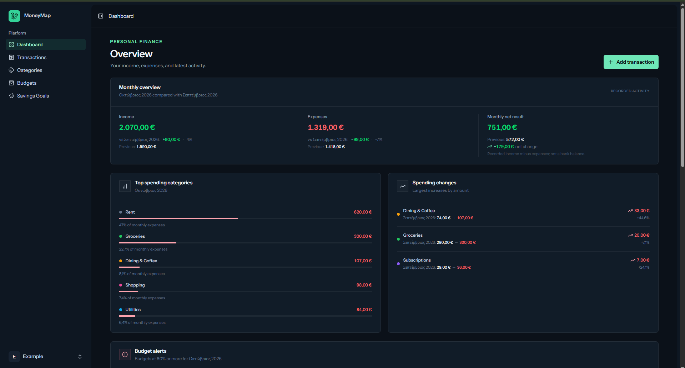
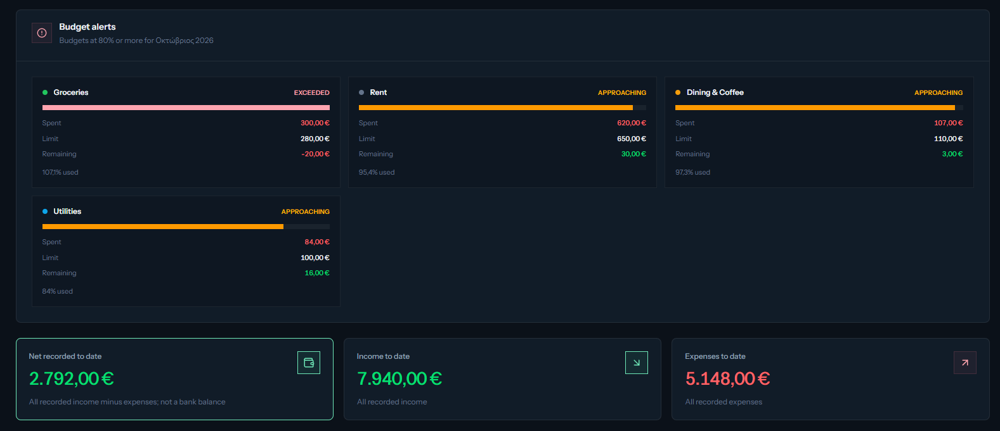
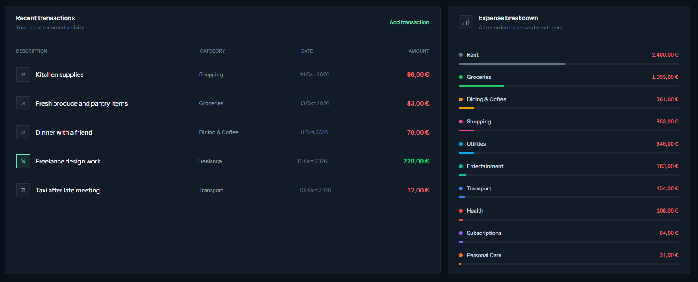
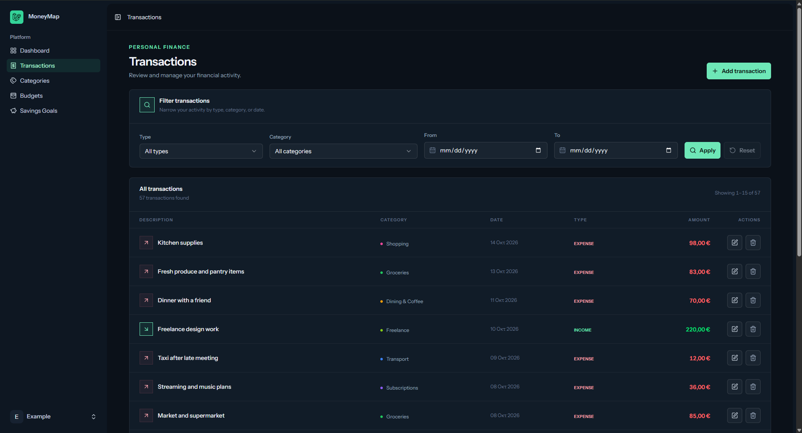
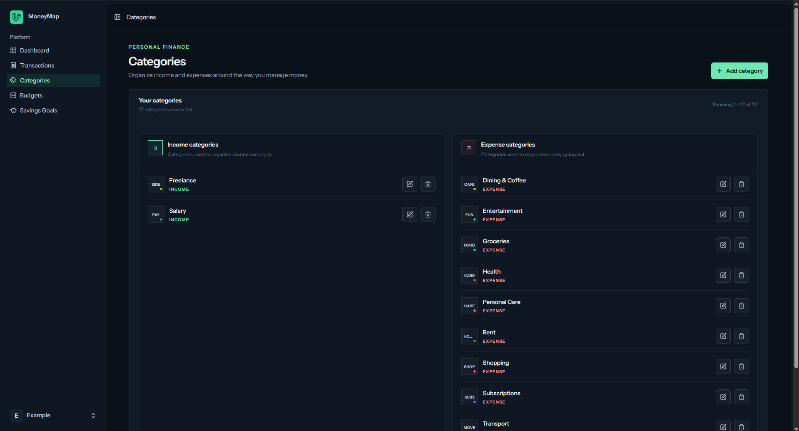
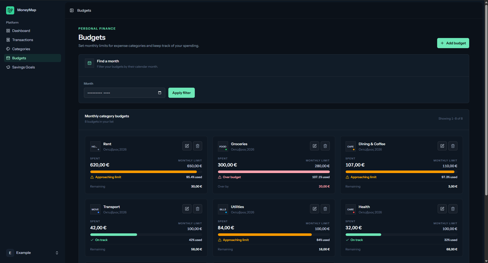

# MoneyMap

**A Full-Stack Personal Finance Management Application**

MoneyMap is a personal finance management application built with Laravel, Vue.js, and TypeScript. It helps users track income and expenses, organize transactions, manage monthly budgets, analyze spending patterns, and monitor savings goals through a modern, responsive interface.

The project combines server-side application logic, relational data modeling, authentication, financial calculations, and interactive frontend components.

## Features

- **Financial Dashboard** — View financial summaries, monthly comparisons, recent transactions, spending patterns, and budget alerts.
- **Transaction Management** — Record and manage income and expenses, assign categories, and review transaction history.
- **Category Management** — Organize financial activity using customizable income and expense categories.
- **Monthly Budgets** — Set category-based spending limits and monitor budget utilization.
- **Financial Insights** — Analyze spending patterns and compare financial activity across periods.
- **Savings Goals** — Create savings targets, track progress, and review contribution and withdrawal history.
- **Responsive Interface** — Access the application across desktop and mobile screen sizes.
- **Theme Preferences** — Switch between Dark, Light, and System appearance modes.
- **Authentication** — Use account-based access to keep financial records separated by user.

## Screenshots

### Dashboard

An overview of financial activity, monthly performance, and spending insights.







### Transactions

Review and manage income and expenses in one place.



### Categories

Organize transactions using income and expense categories.



### Budgets

Monitor monthly spending against category-specific budget limits.



### Savings Goals

Track savings targets, progress, and account activity associated with each goal.


## Technology Stack

| Area | Technologies |
|---|---|
| Backend | PHP, Laravel 13 |
| Database | MySQL / MariaDB |
| Frontend | Vue.js 3, TypeScript |
| Application integration | Inertia.js |
| Styling | Tailwind CSS 4 |
| Authentication | Laravel Fortify |
| Icons | Lucide |
| Build tooling | Vite |
| Testing | Pest, PHPUnit |
| Code formatting | Laravel Pint |

## Architecture and Engineering

The application uses Laravel for backend functionality and Vue.js for its interactive frontend, connected through Inertia.js.

Key implementation areas include:

- Relational database models and migrations.
- User-scoped access to financial records.
- Transaction and category management.
- Date-based financial aggregation and monthly comparisons.
- Budget utilization and spending alerts.
- Savings goal ledgers with contribution and withdrawal history.
- Automated feature tests for application behavior and data isolation.

## Getting Started

### Prerequisites

Install the following tools before setting up the application:

- PHP version compatible with the project requirements.
- Composer.
- Node.js and npm.
- MySQL or MariaDB.
- Git.

### 1. Clone the Repository

Clone the public GitHub repository:

```bash
git clone https://github.com/mkirkos2/MoneyMap.git
cd MoneyMap
```

### 2. Install Dependencies

```bash
composer install
npm install
```

### 3. Configure the Environment

On Windows PowerShell, create the local environment file:

```powershell
Copy-Item .env.example .env
php artisan key:generate
```

If `.env` already exists, do not overwrite it.

### 4. Configure the Database

Create a local database named `moneymap` and configure the database connection in `.env`.

For a typical local MySQL or MariaDB setup:

```env
DB_CONNECTION=mysql
DB_HOST=127.0.0.1
DB_PORT=3306
DB_DATABASE=moneymap
DB_USERNAME=your_database_username
DB_PASSWORD=your_database_password
```

Use the credentials configured for your local database. Never commit `.env` or publish real credentials.

### 5. Run Database Migrations

```bash
php artisan migrate
```

### 6. Start the Application

Start the Laravel and frontend development processes using the project's development script:

```bash
composer run dev
```

Use the local URL reported by the development server. Configure any additional environment settings required by the project before testing features such as email verification.

### 7. Build for Production

```bash
npm run build
```

## Testing and Code Quality

Run the Laravel test suite:

```bash
php artisan test
```

Check PHP code formatting:

```bash
vendor/bin/pint --test
```

Run the production frontend build:

```bash
npm run build
```

Optional test coverage can be generated if the required coverage driver is installed and configured.

## Security Considerations

MoneyMap is designed around authenticated access and user-scoped financial data. When running or deploying the application:

- Keep environment files, application keys, and credentials private.
- Use strong passwords and configure appropriate authentication settings.
- Keep production debug mode disabled.
- Use HTTPS in production.
- Configure email verification and outbound email services as required.
- Review authorization rules and data isolation when adding new features.
- Never publish real financial information or account credentials in screenshots, seed data, or documentation.

## Project Status

MoneyMap is an ongoing full-stack portfolio project focused on personal finance management, data modeling, financial calculations, and modern web application development.